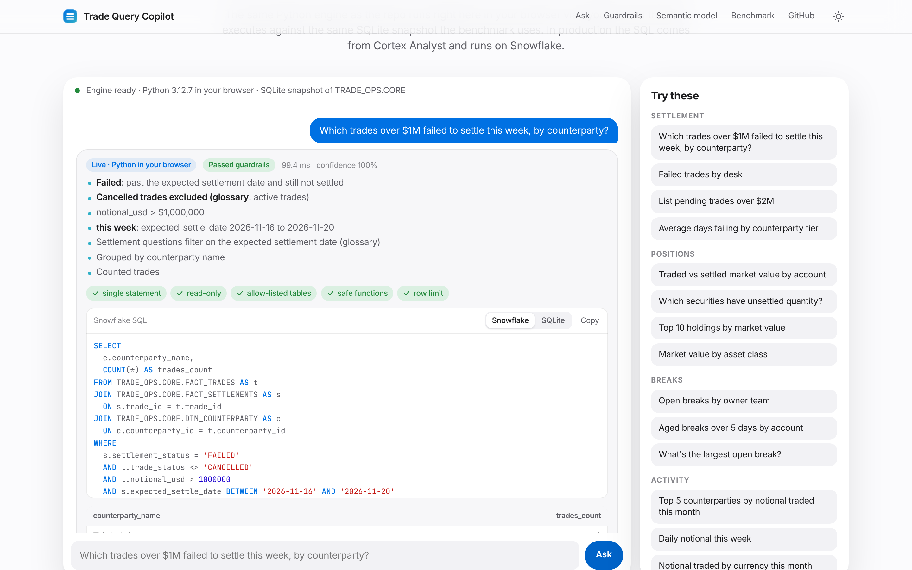

# trade-query-copilot

Text-to-SQL for operations people. Ask *"Which trades over $1M failed to settle this week, by counterparty?"* and get back validated Snowflake SQL, the result, and a plain explanation of how the question was read.

**Live demo: [rahu378.github.io/trade-query-copilot](https://rahu378.github.io/trade-query-copilot/)**

The demo isn't a mock. The Python engine from this repo boots in your browser (Pyodide), and the SQL runs against the same SQLite snapshot the benchmark uses. There's also a guardrail playground where you can try to get a `DROP TABLE` through.



## How it's wired

```
question
  -> Cortex Analyst + semantic_model/trade_ops.yaml        (production, on Snowflake)
     or copilot/local_analyst.py reading the same YAML     (offline, demo, baseline)
  -> copilot/guard.py (sqlglot)                            one statement, SELECT only, TRADE_OPS.CORE allow-list,
                                                           no SYSTEM$ / RESULT_SCAN / COPY, LIMIT <= 1000
  -> Snowflake as COPILOT_READER (SELECT-only role)        or local SQLite (sqlglot transpiles the same SQL)
  -> rows + explanation (+ a chart in Streamlit)
```

Cortex Analyst does the language part. The semantic model and the glossary do most of the real work, because they decide what "failed", "this week", "market value" and "open" mean in this shop.

## Numbers

| | |
|---|---|
| Gold set | 50 questions: settlement, trade activity, positions, breaks, reference data |
| Local engine, execution accuracy | **48 / 50 (96%)** |
| Generated SQL that passed the guardrails | 100% |
| Dev set (what I iterated on) | 20 / 20 |
| Median time to plan + run locally | ~3.5 ms |

How the score is kept honest:

- `eval/gold.yaml` was written before `local_analyst.py` existed, and I only iterated against `eval/dev.yaml`. Two gold questions were reworded once, before any engine code, because the original wording had ties in the data (noted in the file).
- **Execution accuracy**: run the generated SQL and the gold SQL, then compare rows. Order doesn't matter, column names don't matter, extra columns are fine, numbers are compared to 2 decimals. Every gold column has to show up.
- The two misses, which I left alone so the number means something:
  - **G22** "Which positions have traded quantity different from settled quantity?" The parser summed settled quantity instead of listing the positions.
  - **G47** "Fail rate by counterparty this month". A definition fight: the engine counts trades *currently* failing, the gold counts trades that *ever* failed.

The Cortex Analyst number comes from the same harness:

```bash
export SNOWFLAKE_ACCOUNT_URL=https://<org>-<account>.snowflakecomputing.com
export SNOWFLAKE_TOKEN=<programmatic access token>
export SNOWFLAKE_ACCOUNT=<org>-<account> SNOWFLAKE_USER=<you>
python -m copilot.benchmark --engine cortex
```

Heads-up for that run: G01, G06 and G32 are also verified queries in the semantic model, and Cortex leans on those. Report it both ways.

## The semantic model and glossary

`semantic_model/trade_ops.yaml` is the Cortex Analyst model: seven logical tables over `TRADE_OPS.CORE`, relationships, synonyms, sample values, named filters, a few verified queries, and custom instructions for the rules that aren't obvious from column names.

`semantic_model/glossary.yaml` is the business glossary. The ones that matter most:

- **Traded vs settled position.** Traded quantity counts a trade the moment it's booked. Settled quantity only moves when the custodian settles it. The gap is the T+1 / T+2 pipeline plus fails.
- **Base-currency market value** is traded quantity at the close, in USD. Position questions use the latest snapshot unless a date is named. Otherwise "market value by account" quietly adds up five days.
- **Failed** means past the expected settlement date and still not settled. A trade that failed and settled late is `SETTLED` now, but keeps its fail reason.
- **Settlement window.** "Failed this week" filters on the expected settlement date, not the trade date. This is the most common way a naive text-to-SQL gets fails wrong.
- **Open breaks** are `OPEN` + `INVESTIGATING`. **Aged** means open more than 5 business days.
- Trade activity excludes cancelled trades unless you ask about cancellations.

## Guardrails

`copilot/guard.py` runs on every statement, whoever wrote it:

1. parses as Snowflake SQL, exactly one statement
2. read-only: SELECT / UNION only, no DML, DDL, `COPY`, `GRANT`, `CALL` or `SELECT INTO` anywhere in the tree
3. tables: only `TRADE_OPS.CORE` tables on the allow-list (`SNOWFLAKE.ACCOUNT_USAGE` and friends are out)
4. functions: no `SYSTEM$...`, `RESULT_SCAN`, generators
5. row limit: `LIMIT 1000` added if missing, capped if larger

The connection is a second lock. `COPILOT_READER` only has `SELECT` on the schema, `READ` on the model stage and `SNOWFLAKE.CORTEX_USER`. There's a test that feeds a `DELETE` through the Cortex path and checks it never reaches the executor.

## Run it

```bash
pip install -r requirements.txt
python -m copilot.seed                 # data/trade_ops.db + data/csv/
python -m copilot.benchmark            # gold set, local engine
streamlit run app.py
python -m pytest -q
```

On Snowflake:

```bash
snow sql -f snowflake/01_setup.sql     # warehouse, database, stages, COPILOT_READER role
snow sql -f snowflake/02_tables.sql
snow sql -f snowflake/03_load.sql      # PUT + COPY INTO from data/csv
snow sql -f snowflake/04_semantic_model.sql
```

`app.py` also runs as Streamlit in Snowflake. There it picks up the session and calls Cortex through `_snowflake.send_snow_api_request`, so no token is needed.

Rebuild the demo data with `python -m copilot.export_site`.

## Layout

```
copilot/
  seed.py           synthetic trades, settlements, positions, breaks (valid ISIN/CUSIP/LEI check digits)
  local_analyst.py  rule-based NL -> SQL over the semantic model + glossary
  cortex.py         Cortex Analyst client (REST or Streamlit in Snowflake)
  guard.py          sqlglot guardrails
  executor.py       Snowflake (connector / Snowpark) or local SQLite
  pipeline.py       question -> SQL -> guard -> rows -> explanation
  benchmark.py      execution accuracy against eval/*.yaml
  web.py            entry points for the in-browser demo
semantic_model/     trade_ops.yaml (Cortex) + glossary.yaml
snowflake/          setup, DDL, load, model upload
eval/               gold.yaml (50), dev.yaml (20)
app.py              Streamlit chat
docs/               GitHub Pages site
```

## Notes

- Why a rule-based engine next to Cortex: it runs the whole pipeline without an account, it's a baseline Cortex has to beat, and it can run in a browser. If a few hundred lines of rules beat the LLM on your gold set, the semantic model needs work.
- Counterparty, account and ticker names are matched against values pulled from the data. On Snowflake that's what a Cortex Search service on the dimension would do. Wiring that into the model is next.
- Also want to try a semantic view instead of the YAML file, and a multi-turn eval ("now just the ones over $5M").
